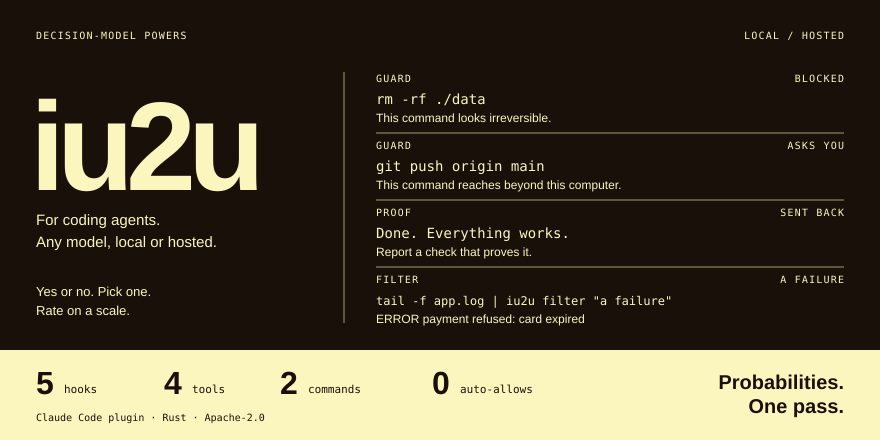

<p align="center">
  
</p>

<h1 align="center">iu2u</h1>

<p align="center">
  <em>Your agent has confidence. Give it judgment.</em>
</p>

<p align="center">
  <a href="https://github.com/falcosan/iu2u/actions/workflows/ci.yml"></a>
  <a href="LICENSE"></a>
</p>

<p align="center">
  
</p>

<p align="center">
  <strong>Decision-model powers for coding agents.</strong><br>
  <sub>Local or hosted. Your model. Your permission rules.</sub>
</p>

<p align="center">
  <a href="#install">Install</a> ·
  <a href="#hooks">Hooks</a> ·
  <a href="#tools">Tools</a> ·
  <a href="#command-line">Command line</a> ·
  <a href="#settings">Settings</a> ·
  <a href="#how-the-guard-decides">Guard behavior</a>
</p>

---

You ask for a small fix. Your agent reaches for `rm -rf`, lines up a push to `main`, and announces that everything works.

You were hoping for a test.

**iu2u gives your agent a second opinion.** A decision model checks shell commands before they run, looks for evidence in completion reports, and helps sift through output. The same model can rank a backlog, search code by meaning, or judge hundreds of items against the same questions.

Five hooks. Four tools. Two shell commands. And one deliberate limit: **the guard never grants permission.** It can block, ask, or leave your existing permission rules in charge.

_iu2u. It's up to you._

## Install

You need **Rust 1.88+**, **Claude Code**, and a **decision-model server**. The server can run locally or be hosted; it must implement `POST /v1/systemone`. Bring its base URL and model name. iu2u does not bundle a model.

**1. Install the binary.**

```sh
cargo install --locked iu2u
```

Make sure `iu2u` is on the `PATH` Claude Code sees.

**2. Add the plugin.**

Replace `YOUR_MODEL` with the model name on your server. Change the URL if the server runs elsewhere.

```sh
claude plugin marketplace add falcosan/iu2u
claude plugin install iu2u@iu2u \
  --config model="YOUR_MODEL" \
  --config base_url="http://127.0.0.1:11435"
```

**3. Configure it inside Claude Code.**

```text
/plugin configure iu2u@iu2u
```

Use this to set a hosted server's API key without putting it in shell history, or to change the model, URL, and hook switches later. You can also set switches during installation with options such as `--config trim=true`.

**`guard` and `proof` start on.** The other hooks are opt-in. All four MCP tools are available to the agent.

Use Claude Code **v2.1.295+** for blocking when the guard cannot launch. Shell commands started through Monitor need **v2.1.314+**.

## Hooks

The agent does not have to remember to call these.

| Hook      | Steps in               | What changes                                                                                                            | Default |
| --------- | ---------------------- | ----------------------------------------------------------------------------------------------------------------------- | ------- |
| `guard`   | Before a shell command | Flags irreversible or risky actions. Blocks or asks; never auto-approves.                                               | On      |
| `proof`   | When an agent finishes | Sends unsupported completion claims back for reported checks, or an explanation of what could not be verified.          | On      |
| `trim`    | After a shell command  | Shortens very long output, preserves blocks with common error and warning markers, and saves the full output to a file. | Off     |
| `compass` | On a prompt            | Suggests a relevant personal or project skill.                                                                          | Off     |
| `prune`   | Before compaction      | Advises which steps to preserve in detail and which to drop.                                                            | Off     |

`proof` checks what the agent **reports**. It does not run tests itself or establish that a reported result is true.

When enabling `trim`, avoid combining it with another hook that redacts command output: only one rewrite is kept.

## Tools

One question, a whole pile of things to ask it about. Available over MCP.

| Tool    | What it does                                                                | Try asking your agent                             |
| ------- | --------------------------------------------------------------------------- | ------------------------------------------------- |
| `weigh` | Applies the same typed questions to up to **500 items**.                    | “Which of these issues describe a regression?”    |
| `rank`  | Orders items by a criterion, highest first.                                 | “Rank these bugs by likely user impact.”          |
| `seek`  | Searches files by meaning and returns file and line ranges.                 | “Find the code that handles expired sessions.”    |
| `lint`  | Checks files against rules in plain language and locates likely violations. | “Find places where an error is silently ignored.” |

## Command line

The same judgment works in a pipe. Configure the server for your shell first:

```sh
export IU2U_MODEL="YOUR_MODEL"
export IU2U_BASE_URL="http://127.0.0.1:11435"
```

Set `IU2U_API_KEY` if your server requires authentication.

### Find the failure, however it was worded

```sh
tail -f app.log | iu2u filter "This line reports a failure"
```

`filter` keeps lines whose probability meets the threshold: **0.5** by default. Raise it with `--at`:

```sh
iu2u filter "This line reports a failure" --at 0.8 < app.log
```

Matching lines stream out in input order. Exit codes follow grep: **0** for a match, **1** for no matches, **2** for an error.

### Drive a browser or a Mac app

`act` runs a script, one sentence per line. It drives a real browser or a native Mac app toward each goal, then checks what the screen shows.

```text
# tests/checkout.e2e
open http://localhost:3000
with email = qa@example.com
with password = $SHOP_PASSWORD
do sign in
do add the cheapest red shirt to the cart
expect the cart shows one red shirt
see "Total"
```

```sh
iu2u act tests/*.e2e
```

| Line                    | What it does                                                                                                                                                                                                                                                                                                                                                                                                                                                                                                                                                             |
| ----------------------- | ------------------------------------------------------------------------------------------------------------------------------------------------------------------------------------------------------------------------------------------------------------------------------------------------------------------------------------------------------------------------------------------------------------------------------------------------------------------------------------------------------------------------------------------------------------------------ |
| `open <url>`            | Opens the page in Chrome, Chromium, Edge or Brave, headless unless `--headful`.                                                                                                                                                                                                                                                                                                                                                                                                                                                                                          |
| `app <name>`            | Opens a Mac app, such as `app Notes`, and drives it through its accessibility tree. It drives the app as it is, with your real documents.                                                                                                                                                                                                                                                                                                                                                                                                                                |
| `with <name> = <value>` | A value the model may type; quote it to keep a leading `$`, such as `"$5"`, or a value that starts with `run `, `file ` or `zip `, such as `"run late"`, as text. `$NAME` reads an environment variable and stays secret: wherever the screen shows the whole value, also encoded in an address, the model sees only its name, and a step stops rather than send it in pieces. Text the page restyles, such as in upper case, is not caught. Use long, unique secrets: a short or common one, such as `2024`, also hides that text elsewhere on the screen or stops the step. Text on the page can steer which field gets a value, so use test-only secrets and open only pages you trust. |
| `with <name> = file <path>` | Files or folders for the page, separated by commas, relative to the current directory; they need to exist only once a `do` goal names them, so an earlier `run` can make them. The model is told which files and folders a `do` goal names, so it opens the right chooser. When a `do` goal names them and the page opens a file chooser, or a file or folder picker (`showOpenFilePicker`, `showDirectoryPicker`, which `act` offers in every browser), `act` gives it what it takes of these, the first file when it takes one, every file when it takes several, or the first folder; a folder keeps its structure, and a folder picker or a zip leaves out the links inside it; until the next `do` the screen shows each chooser or picker with what it takes, one file, several files or a folder, and what it got. A chooser the goal names nothing for is cancelled. |
| `with <name> = zip <folder>` | A folder the page gets as one `<folder>.zip`, given like `file`; each goal that names it zips the folder again, but the file changes only when the folder did, so a page can still read the zip it was given before. |
| `with <name> = run <command>` | A value the command prints on its standard output, such as a test token; what it writes to standard error is left out, and when the command fails only its last line of standard error is shown. It stays secret like `$NAME`. It runs before the first step; a command that prints more than 1 MiB on its standard output is an error. |
| `do <goal>`             | Acts until the goal is reached: press, point at a control to show its tooltip or menu (in a browser), type, choose, Enter, Escape, scroll, and, with a model that sees a page, press a spot that no control stands for, such as a place on a map or a part of a picture; a scroll moves an open dialog, list or menu first, then the page, unless it hides its overflow as behind a modal, then the largest part of it that scrolls on its own, then a frame with more to show, and scrolls again while something is left to scroll. Typing replaces the whole text of a field. A goal may take up to 15 actions; split longer ones. Text in quotes in the goal can be typed too.                                                                                                                                                                                                                                                                                                                                                         |
| `expect <claim>`        | Asks the model whether the screen confirms the claim. It passes, fails or is **inconclusive**, which never passes. On a page or an app it keeps asking, each time the screen changes, until it holds, for up to 5 seconds; `within 30s` waits longer. After the second answer that does not hold, it waits one second before it asks again, then twice as long each time, up to eight seconds, so a screen that keeps changing does not cost a model call for each change; when the time runs out it still asks about a screen that changed since the last answer. When the screen changed while the model judged a claim that holds, it asks about the new screen too, up to twice, and records the last one the claim holds on, so a replay does not wait for a moment that has passed. After a `request`, `run` or `logs`, only `within` sends the request again (a `GET`, `HEAD` or `OPTIONS`), runs the command again or reads the logs again. |
| `see "<text>"`          | Checks that the text is on the screen, without the model; a message that showed since the last action, or the last step other than `see`, `see no`, `expect` or `extract`, and has gone, such as a toast, counts too. Text with `/`, `?`, `&`, `=` or `#`, such as an address or a part of one like `see "$hub/new"` or `see "page=2"`, is also looked for in the address of the page and of each frame in it, so it checks where the browser is; where a link or a picture points is not looked for, so check that with `expect`. It waits up to 5 seconds for it; `see "Published" within 45s` waits longer. After a `request`, `run` or `logs`, `within` sends the request, runs the command or reads the logs again every half second until the text shows, like Playwright's `expect.poll`; a request is sent again only when it is a `GET`, `HEAD` or `OPTIONS`, so a `POST` never runs twice and `within` after one checks its response just once; a try that fails, such as while the server restarts, shows its error and the next try goes on, and a try still going when `within` runs out is stopped. |
| `see no "<text>"`       | Checks that the text is not on the screen, waiting up to 5 seconds, or `within` longer, for it to go. The text needs its quotes, so `see "no results"` still checks text that starts with no. |
| `extract <name> = <what>` | Asks the model which value on the screen is the one described, such as `extract id = the id of the new prototype`, and keeps it as `$name` for the steps after it. It picks among the texts, field values and link addresses of a page, the status line, header values and JSON fields or lines of a response, or the lines of a command's output, leaving out any that holds a secret. The lock file keeps where the value came from, not the value, so a replay takes the new value from the same place; for a page text or an output line, that place is its text with the numbers the step does not mention left out, and the report shows the value, so take a secret with `with <name> = run`, not `extract`; a page text or an output line whose numbers changed, such as `Order 4712` after `Order 4711`, counts as the same place, wherever it moved, when no other text matches it the same way; a place two values share, such as two Edit links, is never replayed, so `--locked` fails there at once. A replay waits up to 5 seconds for the place to show, like `see`. A name that holds a secret cannot take an extracted value. |
| `request <METHOD> <url>` | Sends an HTTP request outside the browser and shows its response, the status line, headers and body, to the `see` and `expect` lines after it; a JSON body shows one line per value with its path, such as `people[0].role: "editor"`, so `see people[0].role: "editor"` checks one field and `see no "people[2]"` the length of a list; any step but `see`, `see no`, `expect` or `extract` goes back to the page, so `wait 1s` after the checks of a response looks at the page again without acting on it. Put headers (`name: value`), a JSON body (`json {...}`, or `json file path` for one saved in a file, read when the request is sent and sent as it is) or form fields (`form name = value`, `form name = file path`) on indented lines under it; form fields are sent URL-encoded, or as multipart when one is a file, which sets its own content type, so leave out a `content-type` header then. A relative address goes to the open page's site. Redirects are shown, not followed, and the response shows only the first 1 MiB of the body; a request that gets no answer within 30 seconds fails. `$name` in a request, `open`, `see` or `expect` takes a `with` or `extract` value or, failing that, the environment variable, which stays secret and is never offered to `do` for typing; inside a string of a `json` body, or of a route's answer that starts with `{` or `[`, the value is escaped for JSON, so quotes in it keep the body valid; `$$` writes a `$`. |
| `route <address> …`     | Changes what the browser gets for every request to that address from then on, like Playwright's `page.route`. An address with `*` matches any characters there; one without matches every address that starts with it. `to <address>` sends the requests there instead, keeping the rest of the address, so a test server can stand in for a real one, such as a sign-in service. `answer <status> [<body> \| file <path>]` answers in place of the server; a body that is JSON goes as `application/json`, one that starts with `<` as HTML, any other as plain text. `hold` keeps the requests waiting, without slowing the steps, until `release <address>`. Write `once` after the address to apply it only to the next request. The latest matching route wins; one for the same address replaces the one before, unless it is `once` or the one before is a `hold`, which only `release` ends. The screen shows how many requests each route has answered and how many a `hold` keeps waiting, so the model knows the page waits on purpose. While a route is set the browser cache is off, as in Playwright, so no request skips the routes. |
| `release <address>`     | Lets the requests held by `route <address> hold` go, waits for the page to take their answers, and stops holding new ones. |
| `back`, `forward`, `reload` | Moves through the page history or reloads the page, like the browser buttons. |
| `wait <time>`           | Lets real time pass, such as `wait 30s`, for timers a step has no other way to wait for; the steps after it look at the page as it is then. |
| `clock install`, `clock freeze`, `clock run <time>` | Like Playwright's `clock.install`, `clock.setFixedTime` and `clock.runFor`: `clock install` gives the pages opened after it, and their frames from the same origin, a clock that keeps real time but that `clock run 30s` moves forward at once, firing on the way every timer (`setTimeout`, `setInterval`) due by then, and moving `Date`, `performance.now` and the time stamp of events with it. `clock freeze` does the same, except that `Date` stays at the moment of that step, even through `clock run`, while timers keep running; it moves one millisecond only when the page handles an event after reading the time, so frameworks that check that an event came after its handler, such as Vue, keep working. A page that says how long ago something was made after that moment, such as `updated just now`, then says the same on every run, however long the run takes. |
| `run <command>`         | Runs the command with `sh` in the current directory and shows its output, standard error mixed in as it was written, and its exit code to the `see` and `expect` lines after it. A command that exits with an error fails the step; one still running after 2 minutes, or its `within`, is stopped, and what it leaves running in the background is stopped when it ends, so start a service with `start`. `with` values whose names are words are in its environment. Only the last MiB of its output is kept, and the screen says so when it cuts it. |
| `start <name> = <command> [at <url>]` | Starts a service for the rest of the script, such as a test server, and stops it with its child processes when the script ends. With `at`, an `http` or `https` address that may use `$name` values, the step waits up to 2 minutes for it to answer, and stops at once if something already answers there, as Playwright's `webServer` does, so a server left running is never tested by mistake. |
| `logs <name>`           | Shows what a started service has printed so far, to the `see` and `expect` lines after it; for a service from `--before`, only what it printed since this script began, so a check never passes on what an earlier script caused. Only the last MiB is shown, and the screen says so when it cuts the start. |
| `inject <javascript>`   | Runs the code in every page the browser opens from then on, before the page's own scripts, like Playwright's `addInitScript`. |
| `use <file>`            | Runs the steps and values of another script here, its path relative to this one, so scripts can share a sign-in. |

Each request asks the model one question, except that an `expect` also asks whether the claim needs sight. A decision first asks which operation to use; when the model answers that the goal is already reached before the step did anything, one more request asks it whether the screen shows the goal reached, and when the model is at least 75% sure it does not, it is asked again for the operation, without that one. A press, a typed value or a chosen option then asks for its target, and asks again with the options in reverse order when there is more than one: `act` acts only when both answers agree. The value or the option is asked for the same way. So a press costs up to three requests, and typing or choosing up to five. A spot is found on the screenshot in two rounds: a grid of numbered cells over the page, then a finer one over an enlarged part around the chosen cell, each asked in both orders of numbers, so it costs up to five requests and `act` presses only when both orders agree; its lock entry is the point and the screen it was pressed on, so a replay presses it only on the same screen. When the model says none of the targets of the operation it chose fits, it is asked again for the operation, without that one. A goal fails as out of reach, or passes as reached before the step did anything, only when the model is at least 75% sure of it, as sure as a claim must be to pass; when it is less sure, `act` waits and asks again, and a second unsure answer in a row fails the step. A request that times out, cannot connect or gets a 429 or 5xx answer is sent again, up to twice, one and then two seconds later, and each try counts as a model call. When a script passes, `act` writes `<script>.lock` next to it; a step's `within` is not part of what the lock remembers it by, so changing the time keeps its record. Later runs replay it: actions whose controls still match, and claims about an unchanged screen, need no model at all. When a control is renamed, up to two requests recognize it, or the model decides afresh. With `--locked`, `act` never asks the model and fails wherever the screen does not match the lock file, so CI stays deterministic. A lock file recorded by an older `act` may no longer match its screens; run once without `--locked` to record it again. Screens are compared without the numbers the step does not mention and without the query and fragment of each address, so dates, times, ids, counters and sign-in codes that change from run to run do not stop a replay, while a number in the step, such as `expect the cart shows 3 items`, still counts, and so does a value the step names, such as `$id` in `expect the toast says prototype $id was created`, which a replay finds wherever the screen shows its new value; a number in an address's query or fragment never does, so check it with `see "page=2"`, and neither does the value of a response header, so check one with `see "cache-control: no-store"`. Of controls that look alike, such as two Pay buttons, a replay presses the one in the same place, and a spot the same point, only on a screen that is the same apart from those numbers; when rows that differ only in a number can change places, name that number in the step, such as `do pay invoice 1002`, so a replay never presses the other one. Without `--locked`, a claim replays only on the very same screen, numbers, address queries and header values included, and asks the model again otherwise; with `--locked`, write the numbers a claim depends on. A step cannot replay locked when its screen shows other text that changes on every run, such as a random word or a time counted from now that `clock freeze` does not hold still, such as `updated 2 minutes ago`, or when the page needs a pause that the screen does not show, such as a form that ignores a quick submit: a replay acts as soon as its control is on the screen. When a script fails with a page open, `act` saves what the page showed as `<script>.failed.png` next to it, unless a secret shows on it, and the report names it; the next run removes it. With `--headful`, the browser opens in a window so you can watch the run.

Without files, `act` reads one script from stdin, so your agent can hand it a task:

```sh
iu2u act <<'EOF'
app Notes
do create a new note that says "Buy milk"
EOF
```

`act` shows each script while it runs: every step with ✓ when it passed, ✗ when it failed or ? when the model could not tell whether a claim holds, its time, the actions it took, and its note, such as how sure the model was, that it saw only part of the screen, or why the step failed. At the end it lists the failures, each with the lines of its script around the failing one, then the scripts, steps, model calls and time in total:

```text
▶ e2e/checkout.e2e
  ✓ open https://shop.example.com 0.9s
  ✓ do add the blue mug to the cart 2.1s
    › pressed button "Add to cart" · in "Blue mug"
  ✗ see "1 item" 5.0s
    → "1 item" is not on the screen
✗ e2e/checkout.e2e 8.0s · 3 model calls

⎯⎯⎯⎯⎯⎯⎯ Failures 1 ⎯⎯⎯⎯⎯⎯⎯

 FAIL  e2e/checkout.e2e:3 › see "1 item"
"1 item" is not on the screen

    1 | open https://shop.example.com
    2 | do add the blue mug to the cart
  > 3 | see "1 item"

⎯⎯⎯⎯⎯⎯⎯⎯⎯⎯⎯⎯⎯⎯⎯⎯⎯⎯⎯⎯⎯

    Scripts  1 failed (1)
      Steps  1 failed | 2 passed (3)
Model calls  3
   Duration  8.0s
```

Colors appear only on a terminal; `NO_COLOR` turns them off and `CLICOLOR_FORCE` turns them on. With `--json`, each script prints one JSON report instead: every step with how it was settled (`browser`, `app`, `model`, `replay`, `healed`, `cache`, `check`, `http`, `shell` or `wait`) and its seconds, the model calls and the final screen text. With `IU2U_VISION=true`, every question about a page also carries a screenshot of the part in view, taken each time `act` looks at the page, after the pictures in it have loaded, so the model sees colours, layout and pictures as well as the text, which also lists what lies out of view; a claim that needs sight is asked again whenever the page looks different, even when its text stays the same, and on every run without `--locked`, since the lock file keeps only the text; while a secret shows anywhere on the page, in a text, field or tooltip or in text that screen readers skip, no screenshot is sent, and a spot is not looked for: a step that finds a secret on the page while the model looks for one stops, so the model never sees its value, though text drawn on a canvas or in a picture is not caught; an app, a response and a command's output get no screenshot, so a claim about how they look says the model only read their text; the server must accept images, as System One does with its `assets` and the `TypeSafe-Danger-Zone-Images` header. Without it, or whenever a question goes without a screenshot, the model is told that the screen comes as text only, so it does not guess how it looks, and `expect` also asks whether the claim needs sight, and says so when it does, since a model that only reads cannot judge how a page looks; a replay with `--locked` checks such a claim against the text alone and says that too. `--before <script>` runs that script once before the others, like Playwright's `webServer`: the services it starts and the values it sets, files and zips included, last until the last script ends, its values can be typed like the script's own, it may hold only values, and if it fails no other script runs. Exit codes: **0** when everything passed, **1** when a step failed, **2** when a script could not run or stopped on an error; the output still lists the steps and actions done before it. Ctrl-C, SIGTERM or SIGHUP, which a closing terminal sends, unless the run was started to ignore it, as `nohup` does, stops the run, the services it started and a command still running, reports the script it stopped as an error with the steps it did, and exits **130**, **143** or **129**.

`act` needs macOS or Linux. For the browser it finds Chrome, Chromium, Edge or Brave; set `IU2U_BROWSER` to use another executable. Every tab shows a page of 1280 by 900, with or without `--headful`, so screenshots and pressed spots are the same on every machine. It accepts `confirm()` dialogs and dismisses `alert()` and `prompt()`, showing them on the screen, ten at most; it asks pages to reduce motion, so a site that honors `prefers-reduced-motion` holds its carousels still and its screens can replay; it follows a tab the page opens to an address, such as a link that opens in a new tab, and that tab loads its first page with the routes, `inject` scripts and clock already set, as in Playwright; when it closes, such as a sign-in popup, `act` goes back to the tab that opened it; a blank tab the page writes into stays behind; the screen shows the page address, where each link and image points (cut to 200 characters, while `see` and `extract` get the whole address) and which links open a new tab, tooltips, which parts are busy, each download with its size once it is done and each address a request failed for, once, without its query and in address order, such as `failed: https://…/logo.png` (an error status is not a failure); it sees and acts inside iframes of any origin, ten at most, and shows the sandbox of each; routes, `inject` scripts, file choosers and pickers reach those iframes too; it offers the model the first 254 controls and the first 6000 characters of a screen, and of a command's output or a service's logs the last ones, where the newest lines are, and says so when it cuts one; `see` always checks the whole screen. A request carries that screen text and one question with up to 254 options, which can pass 10,000 tokens: a model server with less room rejects it, and the step stops with the server's error. Besides the controls with an accessible role, a table row is offered when the page makes it focusable or gives it a click handler of its own, and so is any part the page made clickable without one, such as a `<div>` or `<span>` with a click handler and no `role`, unless it holds another control or wraps the whole page, such as the root a framework like React listens on; the screen marks those as `clickable`, and both are named by what they contain when they have no name of their own. Mac apps open and are driven in the background, so `act` never takes over your keyboard or mouse. An app whose accessibility tree has more than 3000 elements or takes more than 2 seconds to read is cut short, the screen says so, and its runs may not replay with `--locked`. For Mac apps, allow the app that runs `iu2u`, such as your terminal or editor, in **System Settings › Privacy & Security › Accessibility**.

## How it works

A decision model reads text and answers typed questions: **yes or no**, **pick an option**, or **rate on a scale**. It returns probabilities in one pass, without generating a prose response.

iu2u sends the relevant text and questions to your server's `POST /v1/systemone` endpoint, then turns the answers into hook decisions, tool results, or command output. Latency and judgment quality depend on your model and server.

The endpoint matters: a server exposing only a chat-completions API is not sufficient. The wire format lives in [`src/model/protocol.rs`](src/model/protocol.rs).

## How the guard decides

Every evaluated shell command is sent **alone, as data**, with three questions:

1. Would this cause damage that is hard to recover from?
2. Would this act outside the computer? Reading or downloading alone does not count.
3. Could the worst realistic outcome harm shared data, other people, or production?

The first matching rule wins:

| Model signal                                                                              | Guard response                                               |
| ----------------------------------------------------------------------------------------- | ------------------------------------------------------------ |
| Probability of irreversible damage **≥ 0.85**                                             | **Block**                                                    |
| Probability of irreversible damage, external action, or the most severe outcome **≥ 0.5** | **Ask you**                                                  |
| All three signals below **0.5**                                                           | **No permission decision**; the host's rules and mode decide |

The guard never returns `allow`. A misleading command can fool the model into staying silent; that silence still does not grant permission. Your host may nevertheless permit the command under its own rules. Evaluate these thresholds on your model and your own commands.

### If the model cannot judge

An unreachable or unconfigured model, an unusable response, or a command longer than **4,000 characters** takes the fallback path:

| Claude Code mode       | Fallback                                                  |
| ---------------------- | --------------------------------------------------------- |
| Default, edit, or plan | No permission decision; existing rules apply.             |
| Auto or bypass         | Ask for approval.                                         |
| `dontAsk`              | Request approval, which Claude Code converts to a denial. |

If the **hook itself cannot run**—for example, the binary is missing from Claude Code's `PATH` or its version is incompatible—the plugin requests that shell commands be blocked. This requires Claude Code **v2.1.295+**. Restore a working binary before continuing.

## Settings

Inside Claude Code, plugin options take precedence. For standalone commands and Codex, set environment variables.

| Plugin option | Environment variable | Default                          |
| ------------- | -------------------- | -------------------------------- |
| `base_url`    | `IU2U_BASE_URL`      | `http://127.0.0.1:11435`         |
| `model`       | `IU2U_MODEL`         | Required                         |
| `api_key`     | `IU2U_API_KEY`       | None                             |
| —             | `IU2U_TIMEOUT_MS`    | `10000` milliseconds per request |
| `guard`       | `IU2U_GUARD`         | `true`                           |
| `proof`       | `IU2U_PROOF`         | `true`                           |
| `trim`        | `IU2U_TRIM`          | `false`                          |
| `compass`     | `IU2U_COMPASS`       | `false`                          |
| `prune`       | `IU2U_PRUNE`         | `false`                          |
| —             | `IU2U_BROWSER`       | The first browser found          |
| —             | `IU2U_VISION`        | `false`; `true` for a model that sees images |

Use the server's base URL: iu2u appends `/v1/systemone`. The API key is sent as a bearer token. Hook switches accept `true` or `false`.

## Codex

Add `iu2u mcp` as an MCP server in `~/.codex/config.toml`, with `IU2U_MODEL` and the other server settings available to the process. For the guard, register `iu2u hook guard` as a `PreToolUse` command hook with matcher `Bash`.

The Codex adapter cannot request approval from a hook: it **blocks** commands it would ask about in Claude Code. If the model cannot judge, it makes **no permission decision**, leaving Codex's own rules in charge.

## The name

**It's up to you.** The guy in the logo is pointing at the person who gets to decide.

## License

[Apache-2.0](LICENSE).
