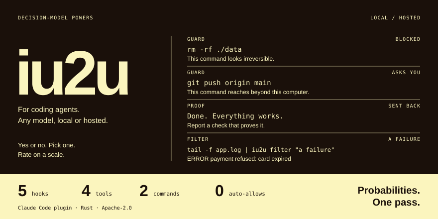

<p align="center">
  
</p>

<h1 align="center">iu2u</h1>

<p align="center">
  <em>Your agent has confidence. Give it judgment.</em>
</p>

<p align="center">
  <a href="https://github.com/falcosan/iu2u/actions/workflows/ci.yml"></a>
  <a href="LICENSE"></a>
</p>

<p align="center">
  
</p>

<p align="center">
  <strong>Decision-model powers for coding agents.</strong><br>
  <sub>Local or hosted. Your model. Your permission rules.</sub>
</p>

<p align="center">
  <a href="#install">Install</a> ·
  <a href="#hooks">Hooks</a> ·
  <a href="#tools">Tools</a> ·
  <a href="#command-line">Command line</a> ·
  <a href="#settings">Settings</a> ·
  <a href="#how-the-guard-decides">Guard behavior</a>
</p>

---

You ask for a small fix. Your agent reaches for `rm -rf`, lines up a push to `main`, and announces that everything works.

You were hoping for a test.

**iu2u gives your agent a second opinion.** A decision model checks shell commands before they run, looks for evidence in completion reports, and helps sift through output. The same model can rank a backlog, search code by meaning, or judge hundreds of items against the same questions.

Five hooks. Four tools. Two shell commands. And one deliberate limit: **the guard never grants permission.** It can block, ask, or leave your existing permission rules in charge.

_iu2u. It's up to you._

## Install

You need **Rust 1.88+**, **Claude Code**, and a **decision-model server**. The server can run locally or be hosted; it must implement `POST /v1/systemone`. Bring its base URL and model name. iu2u does not bundle a model.

**1. Install the binary.**

```sh
cargo install --locked iu2u
```

Make sure `iu2u` is on the `PATH` Claude Code sees.

**2. Add the plugin.**

Replace `YOUR_MODEL` with the model name on your server. Change the URL if the server runs elsewhere.

```sh
claude plugin marketplace add falcosan/iu2u
claude plugin install iu2u@iu2u \
  --config model="YOUR_MODEL" \
  --config base_url="http://127.0.0.1:11435"
```

**3. Configure it inside Claude Code.**

```text
/plugin configure iu2u@iu2u
```

Use this to set a hosted server's API key without putting it in shell history, or to change the model, URL, and hook switches later. You can also set switches during installation with options such as `--config trim=true`.

**`guard` and `proof` start on.** The other hooks are opt-in. All four MCP tools are available to the agent.

Use Claude Code **v2.1.295+** for blocking when the guard cannot launch. Shell commands started through Monitor need **v2.1.314+**.

## Hooks

The agent does not have to remember to call these.

| Hook      | Steps in               | What changes                                                                                                            | Default |
| --------- | ---------------------- | ----------------------------------------------------------------------------------------------------------------------- | ------- |
| `guard`   | Before a shell command | Flags irreversible or risky actions. Blocks or asks; never auto-approves.                                               | On      |
| `proof`   | When an agent finishes | Sends unsupported completion claims back for reported checks, or an explanation of what could not be verified.          | On      |
| `trim`    | After a shell command  | Shortens very long output, preserves blocks with common error and warning markers, and saves the full output to a file. | Off     |
| `compass` | On a prompt            | Suggests a relevant personal or project skill.                                                                          | Off     |
| `prune`   | Before compaction      | Advises which steps to preserve in detail and which to drop.                                                            | Off     |

`proof` checks what the agent **reports**. It does not run tests itself or establish that a reported result is true.

When enabling `trim`, avoid combining it with another hook that redacts command output: only one rewrite is kept.

## Tools

One question, a whole pile of things to ask it about. Available over MCP.

| Tool    | What it does                                                                | Try asking your agent                             |
| ------- | --------------------------------------------------------------------------- | ------------------------------------------------- |
| `weigh` | Applies the same typed questions to up to **500 items**.                    | “Which of these issues describe a regression?”    |
| `rank`  | Orders items by a criterion, highest first.                                 | “Rank these bugs by likely user impact.”          |
| `seek`  | Searches files by meaning and returns file and line ranges.                 | “Find the code that handles expired sessions.”    |
| `lint`  | Checks files against rules in plain language and locates likely violations. | “Find places where an error is silently ignored.” |

## Command line

The same judgment works in a pipe. Configure the server for your shell first:

```sh
export IU2U_MODEL="YOUR_MODEL"
export IU2U_BASE_URL="http://127.0.0.1:11435"
```

Set `IU2U_API_KEY` if your server requires authentication.

### Find the failure, however it was worded

```sh
tail -f app.log | iu2u filter "This line reports a failure"
```

`filter` keeps lines whose probability meets the threshold: **0.5** by default. Raise it with `--at`:

```sh
iu2u filter "This line reports a failure" --at 0.8 < app.log
```

Matching lines stream out in input order. Exit codes follow grep: **0** for a match, **1** for no matches, **2** for an error.

### Drive a browser or a Mac app

`act` runs a script, one sentence per line. It drives a real browser or a native Mac app toward each goal, then checks what the screen shows.

```text
# tests/checkout.e2e
open http://localhost:3000
with email = qa@example.com
with password = $SHOP_PASSWORD
do sign in
do add the cheapest red shirt to the cart
expect the cart shows one red shirt
see "Total"
```

```sh
iu2u act tests/*.e2e
```

| Line                    | What it does                                                                                                                                                                                                                                                                                                                                                                                                                                                                                                                                                             |
| ----------------------- | ------------------------------------------------------------------------------------------------------------------------------------------------------------------------------------------------------------------------------------------------------------------------------------------------------------------------------------------------------------------------------------------------------------------------------------------------------------------------------------------------------------------------------------------------------------------------ |
| `open <url>`            | Opens the page in Chrome, Chromium, Edge or Brave, headless unless `--headful`.                                                                                                                                                                                                                                                                                                                                                                                                                                                                                          |
| `app <name>`            | Opens a Mac app, such as `app Notes`, and drives it through its accessibility tree. It drives the app as it is, with your real documents.                                                                                                                                                                                                                                                                                                                                                                                                                                |
| `with <name> = <value>` | A value the model may type; quote it to keep a leading `$`, such as `"$5"`. `$NAME` reads an environment variable and stays secret: wherever the screen shows the whole value, the model sees only its name, and a step stops rather than send it in pieces. Text the page restyles, such as in upper case, is not caught. Use long, unique secrets: a short or common one, such as `2024`, also hides that text elsewhere on the screen or stops the step. Text on the page can steer which field gets a value, so use test-only secrets and open only pages you trust. |
| `do <goal>`             | Acts until the goal is reached: press, type, choose, Enter, scroll. Typing replaces the whole text of a field. A goal may take up to 15 actions; split longer ones. Text in quotes in the goal can be typed too.                                                                                                                                                                                                                                                                                                                                                         |
| `expect <claim>`        | Asks the model whether the screen confirms the claim. It passes, fails or is **inconclusive**, which never passes.                                                                                                                                                                                                                                                                                                                                                                                                                                                       |
| `see "<text>"`          | Checks that the text is on the screen, without the model.                                                                                                                                                                                                                                                                                                                                                                                                                                                                                                                |

Each request asks the model one question. A decision first asks which operation to use, and that one request is all it takes to confirm a goal. A press, a typed value or a chosen option then asks for its target, and asks again with the options in reverse order when there is more than one: `act` acts only when both answers agree. The value or the option is asked for the same way. So a press costs up to three requests, and typing or choosing up to five. When a script passes, `act` writes `<script>.lock` next to it. Later runs replay it: actions whose controls still match, and claims about an unchanged screen, need no model at all. When a control is renamed, up to two requests recognize it, or the model decides afresh. With `--locked`, `act` never asks the model and fails wherever the screen does not match the lock file, so CI stays deterministic. A step cannot replay locked when its screen shows text that changes on every run, such as a clock or an order number, or when the page needs a pause that the screen does not show, such as a form that ignores a quick submit: a replay acts as soon as its control is on the screen. With `--headful`, the browser opens in a window so you can watch the run.

Without files, `act` reads one script from stdin, so your agent can hand it a task:

```sh
iu2u act <<'EOF'
app Notes
do create a new note that says "Buy milk"
EOF
```

`act` shows each script while it runs: every step with ✓ when it passed, ✗ when it failed or ? when the model could not tell whether a claim holds, its time, the actions it took, and its note, such as how sure the model was, that it saw only part of the screen, or why the step failed. At the end it lists the failures, each with the lines of its script around the failing one, then the scripts, steps, model calls and time in total:

```text
▶ e2e/checkout.e2e
  ✓ open https://shop.example.com 0.9s
  ✓ do add the blue mug to the cart 2.1s
    › pressed button "Add to cart" · in "Blue mug"
  ✗ see "1 item" 5.0s
    → "1 item" is not on the screen
✗ e2e/checkout.e2e 8.0s · 3 model calls

⎯⎯⎯⎯⎯⎯⎯ Failures 1 ⎯⎯⎯⎯⎯⎯⎯

 FAIL  e2e/checkout.e2e:3 › see "1 item"
"1 item" is not on the screen

    1 | open https://shop.example.com
    2 | do add the blue mug to the cart
  > 3 | see "1 item"

⎯⎯⎯⎯⎯⎯⎯⎯⎯⎯⎯⎯⎯⎯⎯⎯⎯⎯⎯⎯⎯

    Scripts  1 failed (1)
      Steps  1 failed | 2 passed (3)
Model calls  3
   Duration  8.0s
```

Colors appear only on a terminal; `NO_COLOR` turns them off and `CLICOLOR_FORCE` turns them on. With `--json`, each script prints one JSON report instead: every step with how it was settled (`browser`, `app`, `model`, `replay`, `healed`, `cache` or `check`) and its seconds, the model calls and the final screen text. Exit codes: **0** when everything passed, **1** when a step failed, **2** when a script could not run or stopped on an error; the output still lists the steps and actions done before it.

`act` needs macOS or Linux. For the browser it finds Chrome, Chromium, Edge or Brave; set `IU2U_BROWSER` to use another executable. It accepts `confirm()` dialogs and dismisses `alert()` and `prompt()`, showing them on the screen, ten at most; it asks pages to reduce motion, so a site that honors `prefers-reduced-motion` holds its carousels still and its screens can replay; it stays on its first tab, does not see inside iframes and offers the model the first 254 controls and the first 6000 characters of a screen, and says so when it cuts one. A request carries that screen text and one question with up to 254 options, which can pass 10,000 tokens: a model server with less room rejects it, and the step stops with the server's error. Only controls with an accessible role can be used: a `<div>` or `<span>` with a click handler and no `role` is not offered. Mac apps open and are driven in the background, so `act` never takes over your keyboard or mouse. An app whose accessibility tree has more than 3000 elements or takes more than 2 seconds to read is cut short, the screen says so, and its runs may not replay with `--locked`. For Mac apps, allow the app that runs `iu2u`, such as your terminal or editor, in **System Settings › Privacy & Security › Accessibility**.

## How it works

A decision model reads text and answers typed questions: **yes or no**, **pick an option**, or **rate on a scale**. It returns probabilities in one pass, without generating a prose response.

iu2u sends the relevant text and questions to your server's `POST /v1/systemone` endpoint, then turns the answers into hook decisions, tool results, or command output. Latency and judgment quality depend on your model and server.

The endpoint matters: a server exposing only a chat-completions API is not sufficient. The wire format lives in [`src/model/protocol.rs`](src/model/protocol.rs).

## How the guard decides

Every evaluated shell command is sent **alone, as data**, with three questions:

1. Would this cause damage that is hard to recover from?
2. Would this act outside the computer? Reading or downloading alone does not count.
3. Could the worst realistic outcome harm shared data, other people, or production?

The first matching rule wins:

| Model signal                                                                              | Guard response                                               |
| ----------------------------------------------------------------------------------------- | ------------------------------------------------------------ |
| Probability of irreversible damage **≥ 0.85**                                             | **Block**                                                    |
| Probability of irreversible damage, external action, or the most severe outcome **≥ 0.5** | **Ask you**                                                  |
| All three signals below **0.5**                                                           | **No permission decision**; the host's rules and mode decide |

The guard never returns `allow`. A misleading command can fool the model into staying silent; that silence still does not grant permission. Your host may nevertheless permit the command under its own rules. Evaluate these thresholds on your model and your own commands.

### If the model cannot judge

An unreachable or unconfigured model, an unusable response, or a command longer than **4,000 characters** takes the fallback path:

| Claude Code mode       | Fallback                                                  |
| ---------------------- | --------------------------------------------------------- |
| Default, edit, or plan | No permission decision; existing rules apply.             |
| Auto or bypass         | Ask for approval.                                         |
| `dontAsk`              | Request approval, which Claude Code converts to a denial. |

If the **hook itself cannot run**—for example, the binary is missing from Claude Code's `PATH` or its version is incompatible—the plugin requests that shell commands be blocked. This requires Claude Code **v2.1.295+**. Restore a working binary before continuing.

## Settings

Inside Claude Code, plugin options take precedence. For standalone commands and Codex, set environment variables.

| Plugin option | Environment variable | Default                          |
| ------------- | -------------------- | -------------------------------- |
| `base_url`    | `IU2U_BASE_URL`      | `http://127.0.0.1:11435`         |
| `model`       | `IU2U_MODEL`         | Required                         |
| `api_key`     | `IU2U_API_KEY`       | None                             |
| —             | `IU2U_TIMEOUT_MS`    | `10000` milliseconds per request |
| `guard`       | `IU2U_GUARD`         | `true`                           |
| `proof`       | `IU2U_PROOF`         | `true`                           |
| `trim`        | `IU2U_TRIM`          | `false`                          |
| `compass`     | `IU2U_COMPASS`       | `false`                          |
| `prune`       | `IU2U_PRUNE`         | `false`                          |
| —             | `IU2U_BROWSER`       | The first browser found          |

Use the server's base URL: iu2u appends `/v1/systemone`. The API key is sent as a bearer token. Hook switches accept `true` or `false`.

## Codex

Add `iu2u mcp` as an MCP server in `~/.codex/config.toml`, with `IU2U_MODEL` and the other server settings available to the process. For the guard, register `iu2u hook guard` as a `PreToolUse` command hook with matcher `Bash`.

The Codex adapter cannot request approval from a hook: it **blocks** commands it would ask about in Claude Code. If the model cannot judge, it makes **no permission decision**, leaving Codex's own rules in charge.

## The name

**It's up to you.** The guy in the logo is pointing at the person who gets to decide.

## License

[Apache-2.0](LICENSE).
